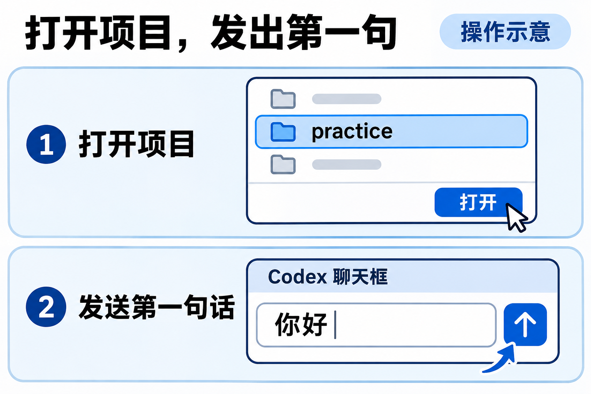
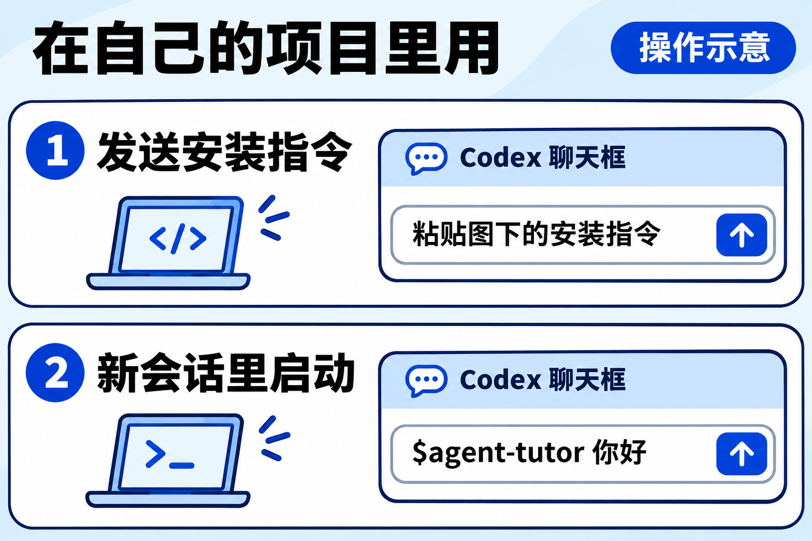

# Agent Tutor · Codex 新手陪练

打开 Codex，说一句你想做的事。Agent Tutor 会带你做一小步，再一起检查结果。

**选一种就好。第一次来，直接用方法一。**

## 方法一｜先试一次（推荐）

1. [下载练习包 ZIP](https://github.com/Loku1210/agent-tutor/releases/download/v0.1.0/Agent-Tutor-v0.1.0.zip)，然后解压。
2. 在 Codex 里添加一个本地项目，选择解压后的 **`practice` 文件夹**。陪练和示例笔记都在里面。
3. 新开一个会话，发送 **你好**。看到它问你「今天想用 Codex 做什么」就可以开始了。



想试做一件小事？接着发：**把示例笔记整理成待办，新建一个文件，原件别动。**

## 方法二｜装一次，在自己的项目里用



把下面整行复制到 **Codex 的聊天框**，发送。

```text
$skill-installer 请从 https://github.com/Loku1210/agent-tutor/tree/v0.1.0/practice/.agents/skills/agent-tutor 安装 Agent Tutor
```

等 Codex 提示安装完成，再打开你自己的项目，新开一个会话，发送 **`$agent-tutor 你好`**。

<details>
<summary>方法三｜手动复制（方法二用不了时）</summary>

1. 下载并解压[练习包 ZIP](https://github.com/Loku1210/agent-tutor/releases/download/v0.1.0/Agent-Tutor-v0.1.0.zip)。
2. 找到 `practice/.agents/skills/agent-tutor`，复制整个 `agent-tutor` 文件夹。看不到 `.agents` 时，macOS 在 Finder 按 `Command + Shift + .`，Windows 在资源管理器中开启「隐藏的项目」。
3. 粘贴到你的个人目录下的 `.agents/skills`。如果目录还没有，就依次创建 `.agents` 和 `skills`。完成后，`SKILL.md` 应位于 `.agents/skills/agent-tutor` 里面。
4. 回到 Codex，新开一个会话，发送 **`$agent-tutor 你好`**。

[Codex 官方安装目录说明](https://learn.chatgpt.com/docs/build-skills#where-codex-loads-local-skills)

</details>

**没打开陪练？** 方法一先检查打开的是 `practice` 文件夹，再试 `$agent-tutor 你好`。方法二或三安装后仍找不到时，重启 Codex 再试一次。
